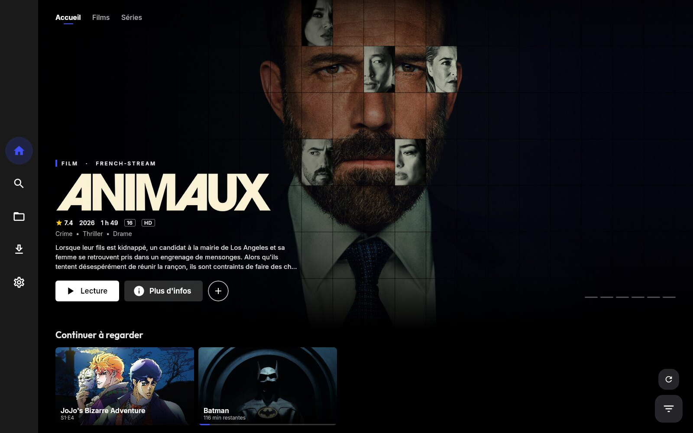
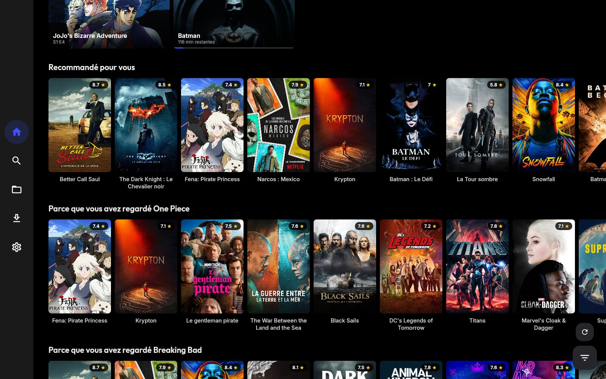
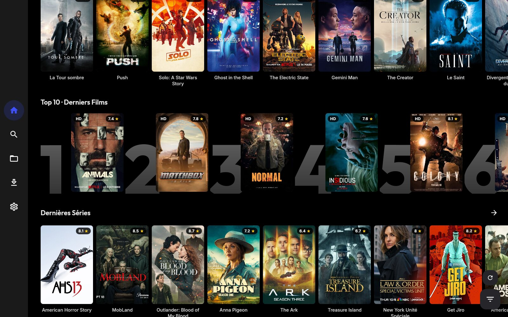
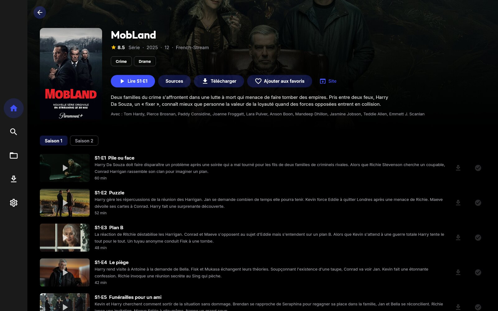
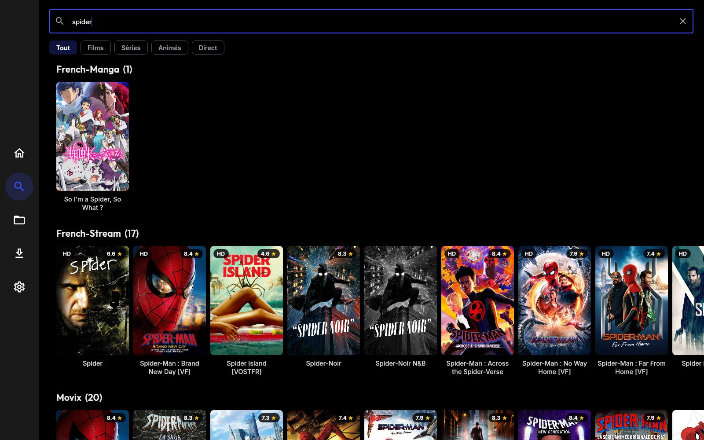
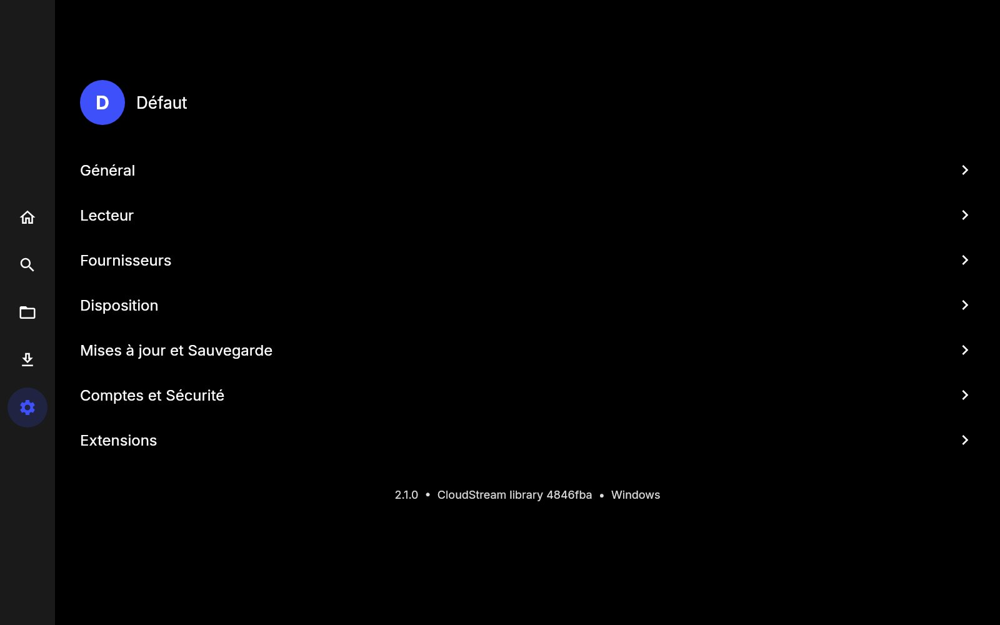
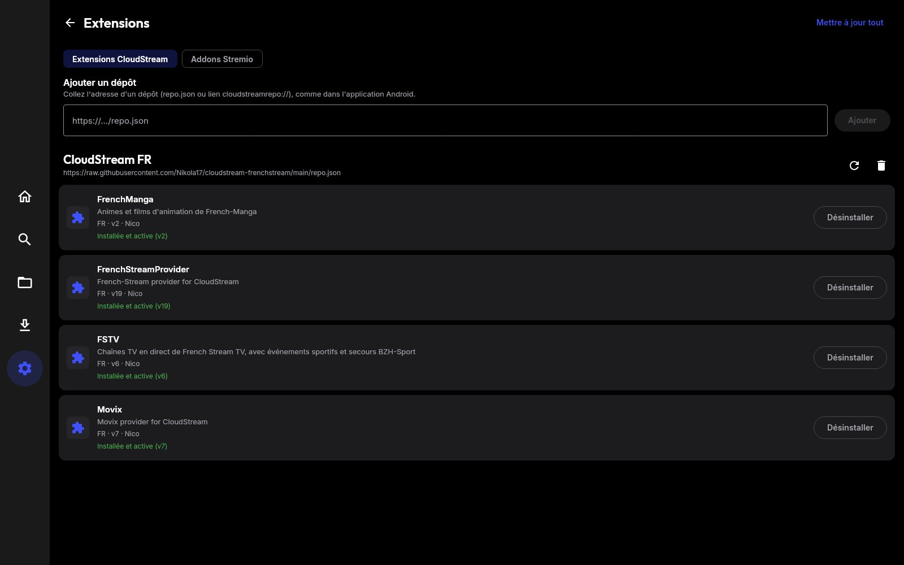
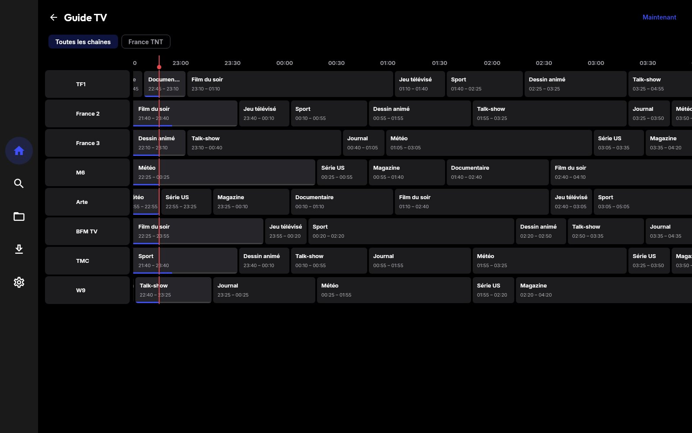

# CloudStreamPC

**CloudStream pour Windows, macOS et Linux.** Une application de bureau qui reprend l'interface et les fonctions de
l'application [CloudStream](https://github.com/recloudstream/cloudstream) (version TV) et charge
**les mêmes extensions (`.cs3`)**, plus les **comptes IPTV** (Xtream Codes / M3U) et les
**addons Stremio**.



## Installation (Windows 10/11, 64 bits)

1. Ouvrez la page [Releases](../../releases/latest).
2. Téléchargez `CloudStreamPC-x.y.z-setup.exe` et lancez-le.
   Version sans installation : `CloudStreamPC-x.y.z-portable.zip`, à décompresser, puis lancez `CloudStreamPC.exe`.
3. Si Windows affiche « Windows a protégé votre ordinateur » (l'application n'est pas signée) :
   cliquez sur **Informations complémentaires** puis **Exécuter quand même**.

Java et le lecteur vidéo [mpv](https://mpv.io) sont inclus : rien d'autre à installer.
Au premier lancement, un assistant propose d'installer les extensions CloudStream FR, d'ajouter un
compte IPTV et le catalogue Stremio.

### Linux (64 bits)

Téléchargez `CloudStreamPC-x.y.z-amd64.deb` (Ubuntu, Debian, Mint…) ou `CloudStreamPC-x.y.z-x86_64.rpm`
(Fedora, openSUSE…) et ouvrez-le, ou `sudo apt install ./CloudStreamPC-x.y.z-amd64.deb`. Sans paquet :
`CloudStreamPC-x.y.z-linux-x64.tar.xz`, à décompresser, puis lancez `CloudStreamPC/bin/CloudStreamPC`.
Installez aussi mpv : `sudo apt install mpv` (ou `sudo dnf install mpv`).
**AppImage** (toutes distributions) : `CloudStreamPC-x.y.z-x86_64.AppImage`, puis `chmod +x` et lancez-le (mpv du système).
**Flatpak** : le manifeste `packaging/flatpak/io.github.nikola17.CloudStreamPC.yml` (mpv inclus) se construit avec
`flatpak-builder` ; il n'est pas encore publié sur Flathub (soumission à faire avec votre compte).

### Windows sur ARM, winget et Scoop

PC à processeur ARM (Snapdragon…) : `CloudStreamPC-x.y.z-arm64-setup.exe` quand la release en contient un
(la compilation ARM est tentée à chaque version ; si elle échoue, la version x64 fonctionne aussi par émulation).
Chaque release contient `CloudStreamPC-x.y.z-manifests.zip` avec les manifestes **winget** (`winget/…`) et
**Scoop** (`scoop/cloudstreampc.json`), déjà remplis avec les adresses et empreintes. Pour que
`winget install Nikola17.CloudStreamPC` fonctionne, il faut les proposer une fois au dépôt
[winget-pkgs](https://github.com/microsoft/winget-pkgs) (pull request avec votre compte GitHub, ou
`wingetcreate submit`) ; pour Scoop, mettre `cloudstreampc.json` dans un dépôt « bucket » à vous
(`scoop bucket add cloudstreampc https://github.com/<vous>/scoop-bucket`, puis `scoop install cloudstreampc`).

### macOS (Apple Silicon et Intel)

Ouvrez `CloudStreamPC-x.y.z-macos-arm64.dmg` (Apple Silicon) ou `-macos-x64.dmg` (Intel) et glissez CloudStreamPC dans Applications, puis installez mpv
(`brew install mpv`, ou l'application mpv dans Applications). L'application n'est pas notariée par Apple :
au premier lancement, faites un clic droit sur CloudStreamPC → **Ouvrir** (ou
`xattr -cr /Applications/CloudStreamPC.app`).

### Mises à jour

Quand une nouvelle version sort, l'application le signale au démarrage (ou Paramètres → Mises à jour et
Sauvegarde → Vérifier les mises à jour). **Installer maintenant** télécharge l'installateur de votre système,
vérifie son empreinte SHA-256 avec celle publiée, le lance et ferme CloudStreamPC ; vos données sont conservées.
La version portable Windows reçoit l'installateur classique.

### Taille

L'application est faite pour être légère à télécharger : installateur compressé en LZMA2 (Windows) ou xz
(Linux), parties inutilisées de l'interface retirées, bibliothèques natives des autres systèmes enlevées,
et outils lourds (moteur torrent, lecteur de bandes-annonces) téléchargés seulement si vous vous en servez.
Par rapport à la version 2.6 : paquet Linux de 142 à 50 Mo. Chaque version publiée est comparée à la précédente,
et la publication s'arrête si un fichier grossit de plus de 10 %.

## Captures d'écran

| | |
|---|---|
|  |  |
| **Recommandations** calculées à partir de ce que vous regardez | **Top 10** et rangées par catégorie |
|  |  |
| **Fiche d'une série** : saisons, épisodes, téléchargement | **Recherche** dans toutes les extensions |
|  |  |
| **Paramètres** organisés comme l'application Android | **Extensions** CloudStream et addons Stremio |


**Guide TV** des comptes IPTV : programme en cours, heure actuelle, lecture d'un clic.

## Fonctionnalités

**Accueil** façon plateforme VOD : grande bannière avec le logo officiel du titre quand il existe, zoom
lent et lecture directe ; onglets Accueil / Films / Séries / Animés / TV ; « Continuer à regarder » en
vignettes paysage (un clic reprend la lecture) ; Top 10 ; rangées avec défilement au survol et « Tout voir » ;
affiches avec badge qualité et note ; bouton filtre en bas à droite pour choisir le fournisseur.
Typographie : Outfit pour les titres et Inter pour le texte (polices libres, SIL OFL).

**Recommandations** sans compte (ni Simkl ni Trakt), calculées sur le PC à partir de ce que vous
regardez : « Recommandé pour vous » et « Parce que vous avez regardé… ». Un titre fini compte plus qu'un
titre abandonné, les favoris comptent aussi, et un titre suggéré par plusieurs de vos films passe devant.
Quand une extension ne propose pas de titres similaires, l'application cherche le même titre dans vos autres
fournisseurs. La croix au survol d'une affiche écarte un titre. Séparées par profil, réglables dans Disposition.

**Lecture** : la meilleure qualité se lance directement, sans choisir (le bouton « Sources » de la fiche
permet de choisir à la main). Si une source ne marche pas, l'application passe à la suivante.
Reprise à la seconde près, épisode coché « vu » à 90 %, sous-titres, langues audio/sous-titres préférées,
vitesse de lecture.

**Lecteur** : mpv avec une interface moderne ([uosc](https://github.com/tomasklaen/uosc)) : barre de
progression avec chapitres, menus des sous-titres, de la piste audio et de la qualité, vitesse, plein écran,
bouton « +85 s ». Par-dessus, les boutons de CloudStreamPC :
- **Passer l'intro / le récap** : pour les animés, temps de la base [AniSkip](https://aniskip.com)
  (comme CloudStream) ; pour les autres vidéos, quand leurs chapitres indiquent l'intro ou le générique.
  Peut aussi passer l'intro automatiquement.
- **Épisode suivant** : apparaît au générique de fin (compte à rebours de 10 s quand le générique est
  connu, sinon à la fin de l'épisode). L'épisode suivant se charge **dans la même fenêtre**, sans quitter le
  plein écran, avec sa meilleure source. Touche `N` ou bouton de la barre de contrôle à tout moment.

**Vidéo dans la fenêtre** (Windows et Linux, expérimental, désactivé par défaut depuis la 3.0.3 : Paramètres → Lecteur) : la vidéo s'affiche dans la fenêtre de l'application, avec une
barre en haut (retour, image dans l'image, plein écran) ; l'interface du lecteur, les boutons et le relais du
direct restent les mêmes. Le plein écran (touche `F`, double-clic ou bouton) agrandit la fenêtre de l'application ;
`Échap` en sort. **Image dans l'image** (bouton ou `Ctrl+P`) : la fenêtre devient un petit lecteur toujours
au-dessus des autres, en bas à droite, déplaçable et redimensionnable. Désactivable dans Paramètres → Lecteur
(mpv rouvre alors sa propre fenêtre). Sous macOS, mpv garde sa fenêtre ; `Ctrl+P` y fait aussi l'image dans l'image.

**Téléchargements** : un film, un épisode ou **toute une saison** (bouton « Télécharger la saison ») ;
sous-titres des langues préférées enregistrés à côté de la vidéo ; **limite de débit** (500 Ko/s à 10 Mo/s)
pour ne pas gêner le reste de la maison ; **heures creuses** (par exemple 1 h → 7 h) : les téléchargements
attendent la plage et s'arrêtent à sa fin pour reprendre ensuite là où ils en étaient.

**Contrôle parental** (Profils → modifier un profil → « Profil enfant ») : âge maximum (6 à 16 ans) lu sur
l'extension puis sur TMDB (classification française d'abord), titres sans âge connu bloqués si vous le
choisissez, contenu NSFW et chaînes adultes cachés, extensions masquées au choix. Pour quitter le profil enfant
ou ouvrir les paramètres, il faut le **code parental**.

**Statistiques et « Ton année »** (Bibliothèque → Statistiques) : temps réellement passé devant les vidéos
(pauses et avances rapides non comptées), films, épisodes, séries terminées, TV en direct, titres et genres
les plus regardés, mois par mois, jours d'affilée. Gardées sur le PC, par profil.

**Santé des extensions** : chaque semaine, chaque site est testé (une recherche, sinon sa page d'accueil) ; un
site qui ne répond plus porte un badge **« En panne »** dans Extensions, avec la raison. « Tester toutes les
extensions » (Paramètres → Fournisseurs) relance le test.

**Apparence des sous-titres** (Paramètres → Lecteur) : taille, couleur, gras, contour, fond, position et décalage,
avec un aperçu.

**Télécommande avec le téléphone** (Paramètres → Lecteur) : scannez le code QR avec le téléphone, sur le même
réseau Wi-Fi (ou ouvrez l'adresse affichée et tapez le code à 4 chiffres). Lecture/pause, ±10 s, +85 s, volume,
sous-titres, piste audio, plein écran, épisode suivant, et en direct chaîne précédente/suivante. Rien ne passe
par Internet. Seuls les appareils du réseau local sont acceptés, avec le code, qui change à chaque démarrage.
Après 5 codes faux, il faut attendre une minute.

**TV en direct sans coupure** : les chaînes IPTV passent par un relais intégré à l'application. Quand le flux
du fournisseur coupe, se fige ou renvoie une erreur, le relais se reconnecte en une fraction de seconde et
recolle le flux ; le lecteur garde quelques secondes d'avance (réglage « Tampon du direct » : 3, 8 ou 20 s)
et l'image continue sans écran noir. Si la chaîne ne revient pas, il passe tout seul sur une source de secours :
l'autre format du même abonnement (MPEG-TS ou HLS), puis la même chaîne sur vos autres comptes IPTV.
Il retire aussi les secondes que le fournisseur renvoie en double à chaque reconnexion (l'image ne recule
pas), détecte un flux figé en 2,5 s, passe tout de suite sur une source libre quand le fournisseur dit
« connexion déjà prise », et garde le lecteur connecté pendant les reconnexions (jamais deux connexions chez
le fournisseur).

Mesures (10 minutes chacune, relais + mpv) :
- **vraie chaîne** France 24 en direct (HLS 1080p, Internet) : aucune pause, aucune image figée ;
- **fournisseur très instable simulé** (coupure toutes les 10 à 40 s, 15 % de flux figés, erreurs 503, place
  gardée 2 s après chaque coupure, panne de 90 s du compte principal) : une seule image figée de 2 s hors de
  la panne double des deux comptes, contre 5 pauses (47 s) et 5 images figées avant cette version.
  Test reproductible : `LiveSoakTest` (`-Dtest.soak=600 -Dtest.soak.sources=…`).
- **Une seule connexion à la fois** au fournisseur (la plupart des abonnements n'en permettent qu'une) : changer de
  chaîne réutilise la même fenêtre et ferme d'abord l'ancien flux.
- **Zapping dans le lecteur** : `Page préc.` / `Page suiv.` (ou les gâchettes de la manette) pour la chaîne
  précédente / suivante, `C` pour la liste des chaînes de la catégorie avec le programme en cours.
- **Revoir** : sur les chaînes qui ont des archives (catch-up), un programme passé du guide se regarde depuis le début.
- Date d'expiration et nombre de connexions de l'abonnement affichés dans Comptes IPTV ; identité du lecteur
  (User-Agent : VLC, IPTV Smarters…) réglable par compte pour les fournisseurs qui l'exigent.

**Guide TV** (bouton « Guide TV » de l'accueil) : grille des programmes des comptes IPTV (guide XMLTV du
fournisseur, mis en cache 12 h), filtre par catégorie, ligne de l'heure actuelle, progression du programme
en cours, jusqu'à 24 h en arrière quand le fournisseur garde des archives ; un clic lance la chaîne.
La fiche d'une chaîne affiche « En ce moment » et « Ensuite ».

**Nouveaux épisodes** : les séries en favoris et celles regardées ces 60 derniers jours sont vérifiées au
démarrage puis toutes les 6 heures. Les sorties apparaissent dans une rangée « Nouveaux épisodes » de
l'accueil, dans la Bibliothèque (pastille sur son icône) et en notification Windows.

**Bandes-annonces** : après quelques secondes sur un titre, la bannière de l'accueil lance sa bande-annonce
sans le son, comme sur les plateformes ; bouton « Bande-annonce » (avec le son) sur les fiches. La vidéo
vient de l'extension ou du catalogue Cinemeta, lue depuis YouTube grâce à [yt-dlp](https://github.com/yt-dlp/yt-dlp)
(téléchargé à la première bande-annonce et tenu à jour, car YouTube change souvent).

**Fiches** : saisons, épisodes, VF/VOSTFR, progression, distribution, recommandations, favoris,
téléchargement d'un film ou d'un épisode. Elles sont complétées par le catalogue Cinemeta (note IMDb, réalisateur, images
des épisodes) et, avec une clé TMDB gratuite (Paramètres → Fournisseurs), par la distribution avec photos, les
titres similaires et les résumés d'épisodes en français.

**Bibliothèque** : « Ma liste » (le « + » des affiches et de la bannière), historique, nouveaux épisodes, listes
de suivi et **collections** à vous (« Soirée SF », « À voir avec les enfants »… : bouton « Collections » des
fiches), avec tri (ajout récent, titre, année) et filtre (films, séries, animés).

**Clavier et manette** : toute l'application se parcourt avec les flèches, `Entrée` et `Échap` (l'élément
sélectionné est entouré). Une manette Xbox, PlayStation ou autre fait de même : croix ou stick pour se déplacer,
A pour ouvrir, B pour revenir, X pour pause, Y pour le plein écran, gâchettes hautes pour avancer ou reculer.

**Mode cinéma** (bouton de l'accueil) : la bannière et ses bandes-annonces en plein cadre, sans la barre latérale.

**Thèmes** : noir (AMOLED), sombre, gris, bleu nuit, bordeaux et forêt, avec la couleur principale au choix.

**Langues** : français, anglais, espagnol, allemand, italien, portugais et arabe (interface en miroir, de droite
à gauche) — Paramètres → Général → Langue de l'application. Les traductions sont des fichiers JSON
(`src/main/resources/i18n/`) : pour en ajouter une, copiez `en.json`, traduisez les valeurs et ajoutez son code
dans `I18n.languages`.

**Sites protégés et extensions « WebView »** : certaines extensions ont besoin d'un vrai navigateur (pages dont
l'adresse vidéo n'apparaît qu'après leur JavaScript, vérification Cloudflare). CloudStreamPC pilote en arrière-plan
le navigateur Chromium déjà installé sur l'ordinateur (Edge, présent sur tout Windows 10/11, Chrome, Brave ou
Chromium), sans rien télécharger de plus. Si un site exige une vérification humaine (captcha), une petite fenêtre
s'ouvre une seule fois ; les cookies obtenus servent ensuite à toutes les extensions.

**Bibliothèque comme CloudStream** : bouton « Statut » des fiches (En cours, À voir, En pause, Abandonné,
Terminé), une section par statut dans la Bibliothèque, synchronisée entre PC et envoyée à AniList, MyAnimeList,
Simkl et Trakt (Trakt : « À voir » = sa liste de suivi).

**Depuis le téléphone** : Paramètres → Mises à jour et Sauvegarde → Importer depuis CloudStream (Android) lit une
sauvegarde de l'application Android (.json) : bibliothèque et statuts, favoris, titres en cours et dépôts
d'extensions.

**En arrière-plan** : fermer la fenêtre garde CloudStreamPC dans la zone de notification (nouveaux épisodes,
téléchargements) ; option « Lancer au démarrage de l'ordinateur », discrètement.

**Suivi** (Paramètres → Comptes et Sécurité → Suivi et synchronisation) : les épisodes et films vus jusqu'au
bout sont envoyés à **AniList** et **MyAnimeList** (animés) et à **Simkl** et **Trakt** (tout). La liste « en cours /
à voir » de chaque compte apparaît dans la Bibliothèque ; un clic cherche le titre dans vos extensions. Ces services
demandent que chaque utilisateur déclare l'application une fois sur leur site (gratuit, une minute) : la fenêtre de
connexion indique quoi remplir, puis la connexion se fait dans le navigateur ou avec un code.

**Synchronisation entre PC** : choisissez un dossier partagé (OneDrive, Google Drive, Dropbox…) présent sur vos
ordinateurs ; favoris, historique, progression et goûts de chaque profil y sont fusionnés automatiquement (ajouts
et suppressions des deux côtés).

**Torrents** : les liens magnet des extensions et des addons Stremio (Torrentio…) se lisent avec le moteur
[TorrServer](https://github.com/YouROK/TorrServer) (téléchargé au premier torrent, 60 Mo, empreinte vérifiée) : la vidéo démarre pendant le téléchargement, et le bon
épisode est choisi dans les torrents de saison complète. Les sources directes restent prioritaires.
Au premier torrent, Windows peut demander d'autoriser TorrServer sur le réseau (nécessaire pour les pairs).

**Caster** (bouton de la fiche) : envoie la meilleure source à un **Chromecast** ou à une **TV DLNA** du réseau,
avec pause et arrêt depuis la barre en bas de l'application. L'application relaie la vidéo avec les en-têtes que
demandent les hébergeurs (et le flux des torrents) ; Windows peut demander d'autoriser CloudStreamPC sur le réseau privé.

**Sous-titres en ligne** : les sous-titres d'OpenSubtitles dans vos langues (Paramètres → Lecteur) sont ajoutés au
menu des sous-titres du lecteur. Décalage des sous-titres dans mpv : `z` / `x`.

**Mémoire de la source** : la source qui a fonctionné pour un titre est relancée en premier la fois suivante.

**Discord** (Paramètres → Général) : affiche le titre et l'épisode en cours sur votre profil Discord ; il faut
l'identifiant d'une application Discord créée une fois sur le portail développeur.

**Recherche** dans tous les fournisseurs à la fois, avec filtres et historique de recherche. Par défaut, un
même titre trouvé chez plusieurs fournisseurs n'apparaît qu'une fois (« 2 sources ») ; « Par fournisseur »
affiche les résultats rangée par rangée.

**Téléchargements** : vidéos directes et flux HLS (y compris chiffrés AES-128), pause / reprise,
téléchargements simultanés, lecture hors connexion.

**IPTV** (Paramètres → Comptes et Sécurité → Comptes IPTV) : abonnement **Xtream Codes** (adresse du
serveur + identifiant + mot de passe) ou **playlist M3U**. Chaque compte devient un fournisseur avec ses
chaînes TV (guide des programmes), films et séries, rangés par catégorie, et recherchables.

**Stremio** (Paramètres → Extensions → Addons Stremio) : ajout d'addons par leur lien `manifest.json`
(catalogues sur l'accueil, recherche, fiches, flux, sous-titres). Préréglages : Cinemeta, OpenSubtitles.
Quand un titre n'a pas de source, un bouton le cherche dans les autres fournisseurs.

**Paramètres** (mêmes rubriques que l'application Android) :
- *Général* : langue (français, anglais), dossier et nombre de téléchargements, manette, Discord, nouveaux épisodes et notifications, **DNS over HTTPS** (« Automatique » par défaut : Cloudflare, sinon le DNS du système, pour passer les blocages des FAI)
  (Cloudflare, Google, AdGuard, Quad9…) contre les blocages des fournisseurs d'accès, liens.
- *Lecteur* : qualité préférée, lecteur (mpv inclus, VLC, autre), lecture directe, épisode suivant,
  progression, plein écran, vitesse, interface du lecteur, « Passer l'intro » (manuel ou automatique),
  bouton « +85 s », sous-titres, langues, cache.
- *Fournisseurs* : langues des extensions, média préféré, badges VF/VOSTFR, NSFW, test de toutes les extensions, clé TMDB.
- *Disposition* : couleur principale, thème (noir, sombre, gris, bleu nuit, bordeaux, forêt), taille des affiches, position du
  titre, badges, bannière, bandes-annonces, distribution, bouton aléatoire, horloge, historique, confirmation avant de quitter.
- *Mises à jour et Sauvegarde* : vérification des mises à jour, sauvegarde / restauration (manuelle
  ou automatique), mise à jour des extensions, journaux, configuration initiale.
- *Comptes et Sécurité* : **profils** (favoris, historique et progression séparés, code par profil,
  « Qui regarde ? » au démarrage), comptes IPTV, addons Stremio, verrouillage de l'application par code.
- *Extensions* : dépôts et extensions CloudStream (installation, mise à jour, désinstallation) et addons Stremio.

Raccourcis : flèches et `Entrée` pour se déplacer et ouvrir ; `Échap`, `Alt+←` ou le bouton « précédent » de la
souris pour revenir en arrière.
Dans mpv : `Espace` pause, `F` plein écran, `←`/`→` ±5 s, `↑`/`↓` ±1 min, `J` sous-titres, `#` piste audio,
`Entrée` « Passer l'intro » / « Épisode suivant » quand le bouton est affiché, `N` épisode suivant, `Q` quitter.

Les données sont dans `%APPDATA%\CloudStreamPC` (macOS : `~/Library/Application Support/CloudStreamPC`,
Linux : `~/.local/share/CloudStreamPC`) ; les téléchargements dans `Vidéos\CloudStreamPC` (macOS : `Films`).

**En cas de problème** : Paramètres → Mises à jour et Sauvegarde → **Signaler un problème** ouvre un
signalement GitHub prérempli (version, système, fin du journal). Si l'application plante, une fenêtre propose
la même chose et le rapport est enregistré dans le dossier `logs`. Les mots de passe, identifiants IPTV, jetons
et clés sont retirés du rapport avant qu'il ne quitte l'ordinateur ; relisez-le avant d'envoyer.

## Signature de l'application

Les versions publiées peuvent être signées (Authenticode SHA-256 horodaté) : installateur `.exe` et
exécutable de l'application. Il faut un certificat de signature de code au nom de son
propriétaire, délivré par une autorité reconnue par Windows (vérification d'identité obligatoire).
Une fois le certificat obtenu, il suffit d'ajouter des secrets au dépôt GitHub (Settings → Secrets and
variables → Actions) ; la compilation signe alors automatiquement :

- **Certificat dans Azure Key Vault** (cas général : depuis 2023 les clés doivent rester dans un module
  matériel) : `AZURE_KEY_VAULT_URI`, `AZURE_CLIENT_ID`, `AZURE_CLIENT_SECRET`, `AZURE_TENANT_ID`, `AZURE_CERT_NAME`.
- **Fichier .pfx** : `WINDOWS_CERTIFICATE_PFX` (contenu du .pfx en base64) et `WINDOWS_CERTIFICATE_PASSWORD`.

Tout est prêt côté compilation : il ne manque que le certificat, qui doit être acheté et établi au nom de
son propriétaire (environ 100 à 400 € par an selon l'autorité ; Azure Trusted Signing est l'option la moins chère).
Pour macOS, la notarisation demande un compte Apple Developer (99 $ par an). Tout est prêt aussi : avec les
secrets `MACOS_CERTIFICATE` (certificat « Developer ID Application » exporté en .p12, en base64),
`MACOS_CERTIFICATE_PASSWORD`, `APPLE_ID`, `APPLE_TEAM_ID` et `APPLE_APP_PASSWORD` (mot de passe d'application
créé sur appleid.apple.com), la compilation signe l'application et les bibliothèques de ses jars avec le
runtime renforcé (`packaging/macos/entitlements.plist`), fait notarier le `.dmg` par Apple et y agrafe le ticket :
plus d'avertissement au premier lancement.

**Tests automatiques** : à chaque version, l'application compilée est lancée sur Windows, Linux et macOS en
mode test (`--smoke-test`) ; elle parcourt ses écrans, joue une image de test dans sa fenêtre et enregistre
une capture de chaque écran (artefacts `captures-…` de la compilation). La publication s'arrête si elle plante.

Sans certificat, les fichiers ne sont pas signés ; leurs empreintes SHA-256 sont publiées dans
`SHA256SUMS.txt` avec chaque version. Le lancement manuel de la compilation propose un test de la chaîne
de signature avec un certificat jetable (sans publier de version).

## Limites connues

- Les torrents dépendent des pairs disponibles ; certains réseaux (entreprise, école) bloquent BitTorrent.
- La diffusion vers une TV DLNA dépend des formats que la TV accepte (les flux HLS sont mieux pris en charge par
  Chromecast).
- Les comptes AniList, MyAnimeList, Simkl et Trakt nécessitent un identifiant d'application que chaque
  utilisateur crée une fois sur le service (CloudStreamPC n'a pas de compte développeur commun).
- Les extensions qui utilisent des fonctions propres à Android (réglages internes, ressources) peuvent
  ne pas fonctionner entièrement.
- Le DNS over HTTPS s'applique aux extensions et au direct (relais), pas aux films lus directement par mpv.
- Le guide TV dépend du guide XMLTV fourni par le compte IPTV ; les chaînes des extensions n'en ont pas.
- « Passer l'intro » n'est automatique que pour les animés présents dans AniSkip et les vidéos à chapitres ;
  ailleurs, le bouton « +85 s » de la barre de contrôle avance d'un générique type.
- Le relais du direct gère les flux MPEG-TS et HLS (y compris chiffrés AES-128) ; les rares chaînes en
  segments fMP4 sont lues directement par mpv, qui se reconnecte aussi tout seul mais sans source de secours.
- Les extensions « WebView » demandent un navigateur Chromium installé (Edge, Chrome, Brave ou Chromium) ;
  Firefox seul ne suffit pas.
- Les positions de lecture à l'intérieur des épisodes ne sont pas reprises d'une sauvegarde Android (le téléphone
  les range sous des numéros internes).
- Les traductions traduisent l'interface, pas le contenu : titres, résumés et genres restent ceux des extensions.
- Les bandes-annonces passent par YouTube : si YouTube change, une mise à jour de yt-dlp (incluse dans
  la version suivante) peut être nécessaire.
- La vidéo dans la fenêtre n'existe pas sous macOS (le système ne permet pas à mpv de dessiner dans la fenêtre
  d'une autre application). Sous Linux, elle demande X11 ou XWayland (cas par défaut).
- L'âge conseillé dépend de ce que donnent l'extension ou TMDB (avec une clé TMDB) : sans l'un ou l'autre, un titre
  passe, sauf si « Bloquer les titres sans âge connu » est activé.
- Les versions Windows ARM, Mac Intel, AppImage et Flatpak sont compilées automatiquement mais n'ont pas été
  essayées sur de vraies machines ; le Flatpak n'est pas encore sur Flathub.
- Pendant la lecture dans la fenêtre, les menus de l'application sont cachés sous la vidéo : « Retour » ou la fin
  de la vidéo les rend.
- Sous macOS et Linux, mpv n'est pas inclus : il faut l'installer (voir Installation). Les versions macOS et
  Linux sont compilées et testées automatiquement mais ont été moins essayées que la version Windows.

## Comment ça marche

- L'API des extensions est la bibliothèque officielle de CloudStream (module `library`, compilé pour la
  JVM), récupérée via JitPack.
- Une extension `.cs3` contient du bytecode Android (DEX). À l'installation, il est converti une fois pour
  toutes en classes Java avec [dex2jar](https://github.com/ThexXTURBOXx/dex2jar), puis chargé comme sur
  Android (`manifest.json` → `pluginClassName` → `load()`).
- L'IPTV et Stremio sont des fournisseurs intégrés qui utilisent la même API que les extensions.
- La position de lecture est lue en direct dans mpv par son IPC (pipe nommé sous Windows) ; la même
  connexion sert au script du lecteur (`app-resources/common/mpv/scripts/cloudstreampc.lua`) pour
  demander l'épisode suivant, que l'application charge dans la fenêtre ouverte.
- Les bandes-annonces de l'accueil sont décodées par mpv en images brutes, affichées dans l'interface :
  le texte de la bannière reste par-dessus.

## Composants inclus

[mpv](https://mpv.io) (GPL), [uosc](https://github.com/tomasklaen/uosc) 5.9.2 (LGPL-2.1, avec une correction :
délai d'animation borné, voir `VERSION.txt`), [QR Code generator](https://www.nayuki.io/page/qr-code-generator-library) (MIT),
téléchargés au premier besoin : [yt-dlp](https://github.com/yt-dlp/yt-dlp) (Unlicense) et [TorrServer](https://github.com/YouROK/TorrServer) MatriX.146.1 (GPL-3.0),
[JmDNS](https://github.com/jmdns/jmdns) (Apache-2.0), [Jamepad](https://github.com/libgdx/Jamepad) et SDL2 (Apache-2.0 / zlib), polices Outfit et Inter (SIL OFL), bibliothèque
CloudStream (GPL-3.0).

## Compiler soi-même

Prérequis : JDK 21.

```bash
./gradlew run                    # lancer l'application
./gradlew test                   # tests (IPTV, guide TV, téléchargements HLS, mpv, AniSkip, dépôts…)
./gradlew test -Dtest.network=true -Dtest.search=true   # tests réseau (extensions réelles, Cinemeta)
./gradlew packageExe packageMsi  # installateurs (à lancer sous Windows)
./gradlew packageDeb packageRpm  # paquets Linux (fakeroot et rpm requis)
./gradlew packageDmg             # image macOS (à lancer sous macOS)
```

Chaque envoi sur `main` compile les installateurs Windows avec GitHub Actions et les publie dans une release.

## Licence

GPL-3.0, comme CloudStream.
